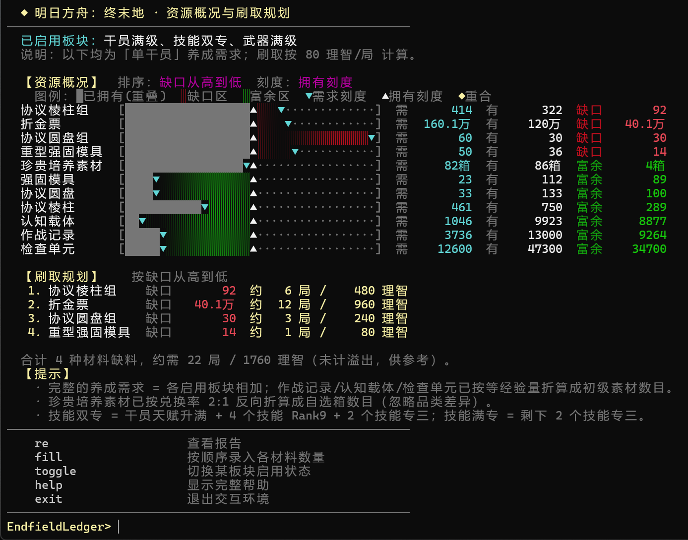

# 明日方舟：终末地 · 资源账本（概况与刷取规划） - EndfieldLedger

一个 PowerShell 脚本，根据《明日方舟：终末地》养成需求与玩家当前实际拥有材料，统计干员培养资源概况，并按缺口给出刷取规划。

## 文件说明

| 文件                        | 说明                            |
| -------------------------- | ----------------------------- |
| `EndfieldLedger.ps1`       | 主程序                           |
| `EndfieldLedger.cmd`       | 可双击运行的启动脚本                    |
| `settings.json`            | 数据文件（板块需求、刷取率、当前拥有、启用板块、提示信息） |
| `README.md`                | 本说明                           |

## 快速开始

1. 打开《明日方舟：终末地》角色界面右上角 `培养总览`，选中一个未拥有的角色，在右边点击 `显示换算结果`，各所需材料图标下方的灰色小字 `拥有 xx` 即为你当前拥有的资源量。
2. 在本程序中输入指令 `fill`，并将这些资源数目填写进去，即可自动生成报告。这些数据将保存在 `settings.json` 里的 `owned` 字段下。
3. 使用 `re` 重新查看报告。使用 `set` 和 `add` 调整单个材料的拥有数目。
4. 使用 `help` 查看完整指令帮助。

## 材料板块

培养一个干员所需的完整材料分为四个板块：
1. 干员满级：包含一个干员从 1 级升至 90 级所需的经验素材和突破素材。
2. 技能双专：包含一个干员将天赋点满 + 4 个技能升至 Rank9 + 2 个技能专三所需的素材。
3. 技能满专：包含一个干员将 2 个技能专三所需的素材。
4. 武器满级：包含一个武器从 1 级升至 90 级所需的经验素材和突破素材。

- 可在报告第一行查看当前启用板块。默认为 `干员满级、技能双专、武器满级` 三个。
- 使用 `toggle` 和 `section` 指令来设置板块。

## 资源概况

- 使用 `sort` 来选择资源概况图表的排序方式：
	- 默认排序 `dafault`：按 `培养总览` 中材料的出现顺序排序。
	- 缺口降序 `shortage`：按材料的缺口数目降序排序。

- 使用 `scale` 来选择资源概况图表的对齐口径：
	- 最大对齐 `aligned`：所有材料数据柱都自适应对齐右边界。
	- 需求刻度 `need`：在不同材料的数据柱上，同等长度的资源量对培养一个干员的贡献相等（刻度`▼`竖直对齐）。
	- 拥有刻度 `owned`：在不同材料的数据柱上，同等长度的资源量在玩家当前拥有资源中占比相等（刻度`▲`竖直对齐）。
	- 理智价值 `sanity`：在不同材料的数据柱上，同等长度的资源量刷取所需理智相等。

## 免责声明

本工具为本地离线计算脚本，不读取、不修改、不干预游戏客户端与游戏数据。使用本工具产生的任何后果由使用者自行承担，作者不对账号安全作任何保证。

---

